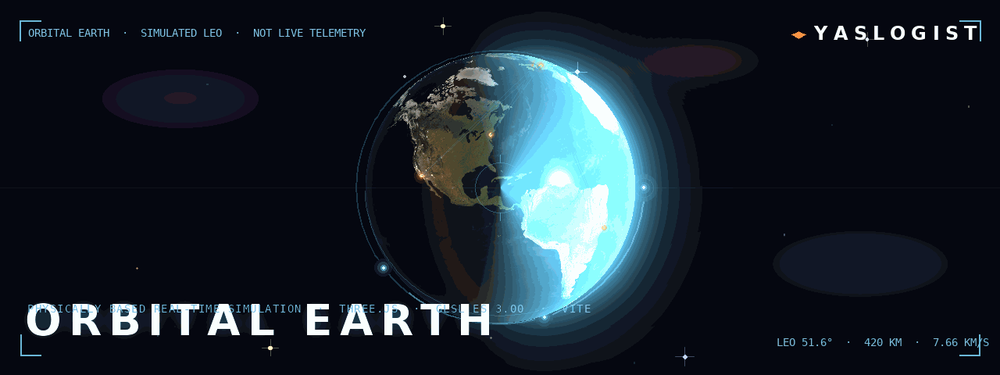
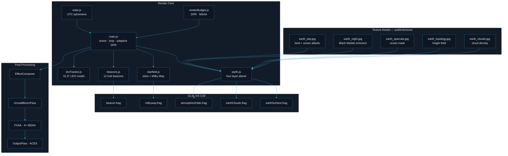
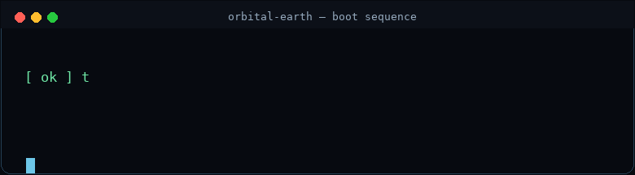
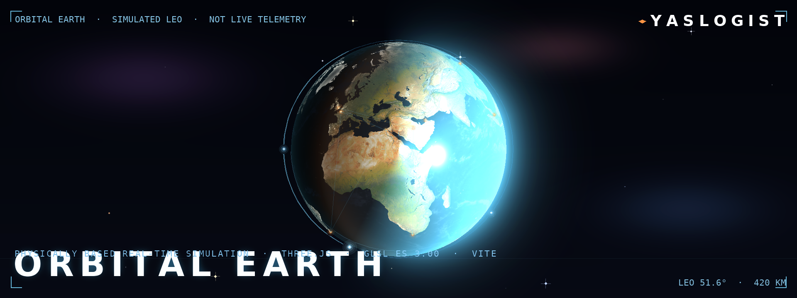

<div align="center">
  
</div>

<div align="center">
  <h1>ORBITAL EARTH</h1>
  <p><strong>A physically based, real-time orbital simulation of Earth.</strong></p>
  <p>
    <em>Earth illumination, cloud shading and atmospheric scattering are rendered from Earth imagery and analytic approximations — not baked scene lighting.</em>
  </p>
  <p>
    <code>THREE.JS</code> &nbsp;·&nbsp; <code>GLSL ES 3.00</code> &nbsp;·&nbsp; <code>VITE</code> &nbsp;·&nbsp; <code>~4 000 LINES OF SHADERS &amp; ENGINE</code>
  </p>
  <p>
    <sub>A <strong>YASLOGIST</strong> engineering showcase</sub>
  </p>
</div>

<div align="center">
  
</div>

---

## 01 / THE SYSTEM

**Orbital Earth** is a browser-based renderer that paints Earth from orbit using hand-written GLSL.
It is not a 3D model with a light bulb attached: the day/night terminator, the red sunset at the
limb, the glitter on the ocean and the glow around the disc are all computed per pixel, every frame,
from the same physical quantities a real atmosphere would produce.

The scene is assembled from four concentric layers around a unit sphere, plus a starfield and an
independent low-Earth-orbit model:

| Layer | Radius (Earth = 1) | Physical meaning |
| --- | --- | --- |
| Surface | `1.0000` | land + ocean, shaded per pixel |
| Cloud tops | `1.0020` | shaped tropospheric clouds (~13 km) |
| Upper cloud veil | `1.0027` | high anvils / cirrus (~17 km) |
| Atmosphere | `1.0280` | single-scattering limb (~178 km) |

Everything is authored in a small, dependency-light engine: **Three.js** for the renderer,
camera and post-processing; **hand-written GLSL ES 3.00** for every surface; **Vite** for the dev
server and bundler; **lil-gui** for the Studio panel; **jpeg-js / pngjs** for the offline texture
pipeline. The axial tilt is the real **23.44°**.

> **Simulation, not telemetry.** Mission overlays such as the LEO tracker are clearly labelled
> simulations. Nothing queries a satellite feed or an external tracking service.

<div align="center">
  
</div>

---

## 02 / CORE CAPABILITIES

| # | Capability | What it actually does |
| --- | --- | --- |
| 01 | **Four-layer planet** | Surface, shaped cloud deck, high-cloud veil and a ray-marched atmosphere shell, each at its own radius. |
| 02 | **Physical surface shading** | Terrain relief from the SRTM/GEBCO height field; ocean optics with a Cook–Torrance GGX sun glitter; per-pixel sunlight transmitted through the atmosphere so the terminator reddens on its own. |
| 03 | **Night-side city lights** | Black Marble emission with the sensor airglow pedestal removed, cloud occlusion and the underglow clouds catch over a city in real ISS photography. |
| 04 | **Shaped cloud deck** | Advected coverage, gradient-following shading normals and a latitude-aware sunward self-shadowing march; a separate high veil for storm systems. |
| 05 | **Single-scattering atmosphere** | A real transmission march along rays that *miss* the planet — 20 deterministic squared-distance samples, Rayleigh + aerosol scale heights, and a faint ~95 km O I airglow band on the night limb. |
| 06 | **Deep space** | ~9 000 stars with a real spectral-class colour ladder and a power-law magnitude distribution, concentrated toward the galactic plane, plus a procedural Milky Way band. |
| 07 | **Orbital-to-city navigation** | A logarithmic depth buffer (13 380 km down to 50 km), quintactic-eased camera arcs to 12 hubs, live telemetry cards and local times from IANA time zones. |
| 08 | **Simulated LEO tracker** | A deterministic, ISS-class circular orbit at 420 km / 51.6° with a moving marker, ground point, orbital path and a cylindrical Earth-shadow test. |
| 09 | **Rendering budget** | HDR targets, 4× MSAA on eligible buffers, FXAA otherwise, and an adaptive pixel ratio that steps down when measured frame time falls behind the display refresh rate. |
| 10 | **Studio controls** | A code-split control panel (fetched only when opened) exposing solar, atmosphere, ocean, cloud, orbital and post-processing parameters. |

### The 12 global hubs

Cairo · Riyadh · Dubai · Tokyo · New York · London · Paris · Singapore · Shanghai ·
Los Angeles · Rio de Janeiro · Cape Town

Each hub carries an emissive beacon, a local time derived from its IANA time zone (including
daylight-saving changes) and a flight target for the camera.

<div align="center">
  
</div>

---

## 03 / ENGINEERING ARCHITECTURE

The engine is deliberately small and readable — roughly **4 000 lines** across 12 modules and 9
shaders. There is no build step between you and the source.

**Render core** — `main.js` owns the scene graph, the animation loop, the camera and the render
budget. It composes a `PerspectiveCamera` (38° FOV, near `0.001`, far `1200`, logarithmic depth
buffer), an `OrbitControls` instance with damping, and an `EffectComposer` chain.

**The planet** — `earth.js` builds the four-layer hierarchy. A group carries the axial tilt about
Z; a nested spin group rotates about the tilted polar axis; the surface, cloud decks, cirrus veil
and beacons hang off the spin, while the atmosphere halo sits outside it. Uniform objects are
shared *by reference* across materials so the surface and the cloud shell read the same advected
cloud coordinate.

**Shaders** — every surface is a hand-written GLSL ES 3.00 program: `earthSurface.frag` (PBR
ocean/land), `earthClouds.frag` (cloud coverage and shading), `atmosphereHalo.frag` (the
single-scattering march), `milkyway.frag` and `starfield.frag` (deep space), and `beacon.frag`
(emissive hub markers). Shared GLSL libraries — `lib/atmosphere.glsl`, `lib/clouds.glsl`,
`lib/noise.glsl` — are composed in `shaderManifest.js` so the offline checker validates
byte-for-byte what the app compiles.

**Support modules** — `solar.js` computes the subsolar point from a low-precision solar ephemeris
(~0.01° accuracy, 1950–2050); `geo.js` converts lat/lon to a point on the sphere; `cities.js`
holds the hub directory; `leoTracker.js` owns the orbital model; `renderBudget.js` decides the
device pixel ratio and MSAA eligibility.

**Texture pipeline** — `scripts/fetch-assets.mjs` rebuilds any missing 4096×2048 map from source
and repairs the cloud map (5×5 median plus a vertical pass) because the source mosaic carries
salt-and-pepper noise and swath seams visible from 50 km. `predev` / `prebuild` verify the maps
and skip the pipeline when they are already valid.

<div align="center">
  
</div>

---

## 04 / SYSTEM BLUEPRINT



<div align="center">
  
</div>

---

## 05 / EXECUTION INTELLIGENCE

Startup is a deterministic sequence: load the five texture maps, compile every shader during the
loader (so there is no first-use compilation in the active scene), size the render targets from
the device profile, then hand control to the animation loop. The Studio panel is fetched on demand
and never adds to the initial JavaScript request.

<div align="center">
  
</div>

**Runtime flow**

1. **Acquire** — verify the five texture maps; rebuild anything missing.
2. **Compile** — compose and validate every shader program before the first frame.
3. **Size** — choose the device pixel ratio from the CSS viewport and the render-pixel budget;
   reserve 4× float MSAA for small, fine-pointer targets, fall back to FXAA otherwise.
4. **Frame** — advance solar position, spin the planet, advect the clouds, advance the LEO model,
   then render through `RenderPass → UnrealBloomPass → (MSAA / FXAA) → OutputPass`.
5. **Adapt** — if smoothed frame time falls below 75% of the measured refresh rate for two
   consecutive samples, step the pixel ratio down by 0.2; recover toward the cap when headroom
   returns. Steps are gated by a dwell timer to avoid oscillation.

The profile HUD (`?profile=1`) reports RAF FPS/frame time, draw calls and triangles, Three.js
texture/geometry counts, an estimated GPU allocation and CPU render-submit time. GPU memory is
estimated from uncompressed RGBA8 textures and render targets; submit time is a CPU timer, **not**
a GPU timer.

<div align="center">
  
</div>

---

## 06 / IGNITION

```bash
npm install
npm run dev          # http://localhost:5173
```

The dev server binds `0.0.0.0` and accepts proxied preview hosts.

### Textures

`public/textures/` ships with five 4096×2048 maps:

| File | Contents |
| --- | --- |
| `earth_day.jpg` | True-colour land albedo + neutral deep-water base |
| `earth_night.jpg` | Black Marble emission, airglow pedestal removed |
| `earth_specular.jpg` | Anti-aliased ocean mask |
| `earth_topology.jpg` | Continuous height field (bathymetry + SRTM) |
| `earth_clouds.jpg` | Cloud optical density, median-filtered |

```bash
npm run fetch-assets           # rebuild anything missing
npm run fetch-assets -- --force  # rebuild all five
```

### Verification

```bash
npm run check
```

Runs the full offline suite: shader/compiler and uniform-contract checks, static JavaScript
runtime checks, city-directory/time-zone invariants, LEO orbit geometry, and DPR-aware
post-processing sizing tests. The shader check composes each program the way the app does,
resolves Three.js `#include` chunks, parses and validates every stage with
[naga](https://github.com/gfx-rs/wgpu) (the wgpu shader compiler), and cross-checks that every
declared uniform is supplied by JavaScript. It runs without a GPU, so it works in CI.

```bash
npm run check:shaders       # shader validation only
npm run profile:rendering   # asset/geometry + post-processing memory estimates
```

### Production

```bash
npm run build
npm run preview
```

<div align="center">
  
</div>

---

## 07 / DEEP SYSTEM ACCESS

<details open>
  <summary><strong>Surface — how the planet is shaded</strong></summary>

  The albedo map is deliberately un-lit; relief, ocean optics, cloud shadows and haze are all
  computed in the fragment shader.

  - **Terrain relief** from the SRTM/GEBCO height field (tangent-space normals, with the
    grazing-angle accentuation that makes mountain ranges pop near the terminator).
  - **Ocean shading**: depth-stratified water colour, a Schlick–Fresnel sky term gated to the day
    side (the night ocean stays pitch black), and a Cook–Torrance GGX sun glitter whose roughness
    widens with altitude.
  - **Real sunlight colour**: sunlight is transmitted through the atmosphere per pixel, so the
    terminator reddens on its own instead of being painted on.
  - **Urban detail on descent**: the Black Marble city map drives procedurally generated street
    grids, district masks and farmland mosaic — detail appears only when a texel still covers
    several pixels, so it never aliases.
  - **Night side**: Black Marble emission with the sensor's airglow pedestal removed, cloud
    occlusion and the underglow that clouds over a city catch in real ISS photos.

</details>

<details>
  <summary><strong>Clouds — why there are two decks</strong></summary>

  A redundant lower shell was removed: it repeated the same 2D coverage map and added opacity
  without adding observed cloud-height data. The remaining main deck and upper veil each have a
  distinct role.

  - Coverage stays soft in orbit, then resolves into cloud puffs and clear gaps on descent instead
    of magnifying into grey smoke.
  - Shading normals follow the cloud-density gradient; a three-tap, latitude-aware sunward march
    adds self-shadowing without distorting longitude/latitude distances.
  - The high veil is restricted to dense storm systems and uses a faster upper-level drift plus
    globe-local ice filaments. Rare, soft night flashes are tied to dense storm cells rather than
    placed randomly across the globe.
  - Screen-footprint LOD filters procedural detail to avoid UV seams, polar pinching and
    sub-pixel shimmer.

  These are approximations, not a separate satellite-observed cloud-height map.

</details>

<details>
  <summary><strong>Atmosphere — the scattering march</strong></summary>

  - Only rays that *miss* the planet are integrated; rays that hit the surface get their airlight
    from the surface shader (otherwise the scattering is counted twice and the disc turns milky).
  - Twenty deterministic squared-distance samples span the complete atmospheric chord and cluster
    around closest approach, resolving dense air without adding grain or increasing the march
    budget.
  - Rayleigh and aerosol extinction use their separate scale heights; each sample includes both
    Sun-to-sample and sample-to-camera transmittance, plus a faint ~95 km O I airglow band on the
    night limb.

</details>

<details>
  <summary><strong>Deep space — the starfield</strong></summary>

  - ~9 000 stars with a real spectral-class colour distribution and a power-law magnitude
    distribution, concentrated toward the galactic plane.
  - A procedural **Milky Way** band: star clouds, dust lanes and a Sagittarius bulge, generated
    from the same value-noise field that positions the resolved stars — so the resolved stars sit
    inside the luminous band instead of being sprinkled over it independently.
  - Diffraction spikes only on the brightest stars; no twinkle (there is no air).

</details>

<details>
  <summary><strong>Orbital-to-city navigation</strong></summary>

  - A logarithmic depth buffer spans 13 380 km down to 50 km with no clipping or z-fighting.
  - Quintactic-eased camera arcs fly to 12 hubs, with live telemetry cards and local times derived
    from IANA time zones (including daylight-saving changes).
  - Click the globe near a hub to fly there, or use the ribbon. Dismissing a city card leaves a
    persistent route back to orbital view.

</details>

<details>
  <summary><strong>Simulated LEO mission overlay</strong></summary>

  - A deterministic, ISS-class circular orbit at 420 km altitude and 51.6° inclination, calculated
    from the standard Earth gravitational parameter (μ = 398 600.4418 km³/s²). Its period and speed
    are derived from the same orbital model.
  - A moving satellite marker, orbital path, Earth-fixed ground point, changing
    latitude/longitude, orbit phase, and a simplified cylindrical Earth-shadow status.
  - Adjust simulation time from paused to 240× in Studio, hide/show the overlay, or have the
    camera follow the marker. The ground point accounts for the rotating Earth, not just the
    orbital plane.

  This is an **educational visualization, not live spacecraft telemetry**. The orbit uses
  Earth-normalized scale; its billboard marker is enlarged for legibility. Orbit time warp is
  independent of the globe's visual spin.

</details>

<details>
  <summary><strong>Live controls — Studio panel</strong></summary>

  | Group | Controls |
  | --- | --- |
  | Solar & Ephemeris | real-UTC sync, manual sun lat/lon, intensity |
  | Atmosphere & Scattering | Rayleigh density, limb visibility, city emission |
  | Ocean & Terrain | sun glitter, sea roughness, wave detail, terrain detail, relief |
  | Cloud Decks | zonal drift, density, relief, microdetail, night-flash intensity, main/high-layer visibility |
  | Orbital Dynamics | auto-spin, spin velocity, simulated LEO visibility, 0–240× orbit time warp |
  | Optics & Post | exposure, bloom strength/radius/threshold, stars, Milky Way |

  The satellite icon in the upper-right opens the telemetry panel. Its **Track Satellite** button
  follows the illustrative marker and yields cleanly to city flights and orbit reset.

</details>

<div align="center">
  
</div>

---

## 08 / ENGINEERING STATUS

Every claim below is backed by a check that runs without a GPU.

| Area | Status | Evidence |
| --- | --- | --- |
| Four-layer planet & surface shading | **Implemented** | `earth.js`, `earthSurface.frag`, `check:shaders` |
| Cloud deck & high veil | **Implemented** | `earthClouds.frag`, `cloud.vert` |
| Single-scattering atmosphere | **Implemented** | `atmosphereHalo.frag`, `lib/atmosphere.glsl` |
| Deep-space starfield & Milky Way | **Implemented** | `starfield.js`, `galacticField.js`, `milkyway.frag` |
| Orbital-to-city navigation | **Implemented** | `cities.js`, `geo.js`, `check:cities` |
| Simulated LEO tracker | **Implemented** | `leoTracker.js`, `check:leo` |
| Adaptive rendering budget | **Implemented** | `renderBudget.js`, `check:postprocessing` |
| Static JS runtime safety | **Implemented** | `check:runtime` (acorn-based) |
| Offline texture pipeline | **Implemented** | `scripts/fetch-assets.mjs` |
| Cloud model | **Approximation** | coverage/shading approximations, not a satellite cloud-height map |
| Urban detail | **Approximation** | procedural street grids from Black Marble, LOD-gated |
| Live spacecraft telemetry | **Not included** | by design — educational visualization only |

<div align="center">
  
</div>

---

## 09 / YASLOGIST

<div align="center">
  
</div>

<div align="center">

  **ORBITAL EARTH** is a member of the **YASLOGIST** engineering showcase — a permanent
  creative signature applied across a family of repositories. Each project keeps its own
  identity; YASLOGIST supplies the shared visual language, the motion philosophy and the
  typographic system you see above.

  <br />

  <a href="https://www.yaslogist.com"><strong>yaslogist.com</strong></a>
  &nbsp;·&nbsp;
  <a href="https://github.com/YASLOGIST/yastera"><strong>github.com/YASLOGIST/yastera</strong></a>

  <br /><br />

  
  <br />
  <sub>Static poster · 1920 × 720 · <code>assets/readme/yaslogist-hero.png</code></sub>

</div>

<br />

<div align="center">
  <sub>
    MIT License · Built with Three.js, hand-written GLSL ES 3.00 and Vite ·
    <strong>YASLOGIST</strong>
  </sub>
</div>
